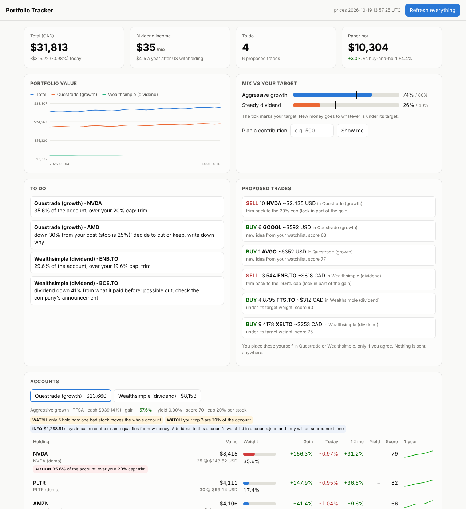

# Portfolio Tracker

A personal investing workbench for a Canadian investor, in plain Python with
nothing to install. It looks after two real accounts with different
jobs, an aggressive growth account at **Questrade** (US stocks) and a steady
dividend account at **Wealthsimple**, and adds a daily briefing, a local
dashboard and a paper-trading bot that has to prove itself before anyone
trusts it.



*The dashboard with made-up demo holdings and simulated prices.*

## What it does

| | |
| --- | --- |
| **Reviews each account against its own strategy** | Growth: momentum, trend, a stop from your cost, trims winners that outgrow the cap. Medium term: trend-following, flags broken trends. Dividend: yield in a sane band, dividend growth, cut detection, volatility, projected monthly income. |
| **Plans your next contribution** | Splits new money toward your target mix (say 60 % growth, 40 % dividend), then inside each account to the holdings under target. No buy ever pushes a stock past its cap. |
| **Knows it is Canadian** | Values everything in CAD with live USD/CAD, knows US dividends lose 15 % in a TFSA but not in an RRSP, flags when you need to convert currency, and warns that day trading in a TFSA can be taxed as business income. |
| **Runs a daily briefing** | One command: sync Questrade, refresh prices and dividends, review, record the day's value, run the paper bot, check news on your holdings, new Congress stock-trade filings and your price alerts. |
| **Shows it all on a dashboard** | A local web page: total and today's change, value history, mix vs target, to-dos, proposed trades, holdings with flags and sparklines, the paper bot vs buy-and-hold, news, Congress filings, CSV import. Light and dark mode, works on a phone. |
| **Paper-trades automatically** | An ATR breakout bot from my [ATR research project](https://github.com/Keneisha3/ATR-Based-News-Triggered-Stock-System) trades a paper ledger every day, with a 5-year backtest and a "ready for real money?" checklist it has to pass. |
| **Runs a crypto bot team on fake money** | A Scanner, Analyst, Risk Manager and Executor trade 10 coins on daily bars, checked every 15 minutes (EMA crossover + RSI, 2 % max risk, stop-loss and take-profit on every trade). Simulated by default, or Alpaca's paper account. CSV log, daily summary against buy-and-hold, kill switch. [Beginner guide](docs/crypto-bot-team.md). |
| **Never trades for you** | Proposals are a to-do list. You place every real trade yourself in your broker's app. |

## Quick start

You need Python 3.9 or newer. There is nothing to pip install.

```bash
git clone https://github.com/Keneisha3/public-stock-trade-tracker.git
cd public-stock-trade-tracker
python3 trade.py dashboard --open     # opens http://127.0.0.1:8765
```

The first screen sets things up. Pick **Try it with demo holdings** to see it
working, or **Set up my accounts** to start real. Then get your holdings in:

- **Wealthsimple:** export the holdings report as CSV from the web app and
  upload it on the dashboard (or `python3 trade.py accounts import wealthsimple file.csv`).
- **Questrade:** in Questrade's App Hub, register a personal app with read
  access and generate a token, then run this once:
  `python3 trade.py accounts sync questrade --token YOUR_TOKEN`.
  The token rotates on every login and is kept in `trader/state/` (mode 600).
  After that, **Refresh everything** syncs it for you.
- Set cash balances on the dashboard.

Press **Refresh everything** once a day, or schedule the daily run (below).

Optional: set `SEC_USER_AGENT="Your Name you@example.com"` to include SEC
filings in the news. Install `pdftotext` (poppler) so the Congress tracker
can read disclosure PDFs.

## Ask in plain words

The `.claude/skills/` folder holds a skill for every tool, so an AI coding
assistant opened in this folder can run them from plain requests:

| Say | Skill |
| --- | --- |
| "set me up", "change my target mix" | `/trader-init` |
| "review my portfolio", "where should my next $500 go?" | `/trader-accounts` |
| "morning briefing", "what happened today?" | `/trader-daily` |
| "backtest the bot", "how is the paper bot doing?" | `/trader-paper` |
| "copy Berkshire's top 5" | `/trader-copycat` |
| "any news on my stocks?" | `/trader-news` |
| "what is Pelosi buying?" | `/trader-pelosi` |
| "how did Apple's earnings look?" | `/trader-analyst` |
| "screen for growing companies under 30x earnings" | `/trader-screener` |
| "size this to $5,000" / "check these orders" | `/trader-budget` / `/trader-risk` |
| "tax-loss harvest", "alert me if NVDA drops to 150", "rebalance" | `/trader-tax`, `/trader-alerts`, `/trader-rebalance` |
| "run the crypto bot", "how did the bot team do?", "kill the bot" | `/trader-team` |
| "place the order" (paper by default, a yes per order) | `/trader-broker` |

Two plugins are switched on in the project settings:
[Agent Skills](https://github.com/addyosmani/agent-skills) (spec, test-first,
security and code-review workflows) and
[Ponytail](https://github.com/DietrichGebert/ponytail) (smallest,
standard-library-first changes; needs Node.js).

## The command line

Everything goes through `trade.py`. Add `--help` to any command:

```bash
python3 trade.py init --with-medium --mix growth=50,medium=20,dividend=30
python3 trade.py accounts market                  # prices, dividends, USD/CAD
python3 trade.py accounts review                  # flags + proposals per account
python3 trade.py accounts review --contribute 1000
python3 trade.py daily                            # the whole daily run
python3 trade.py paper backtest                   # stock bot: 5 years vs buy-and-hold
python3 trade.py paper status                     # equity, trades, readiness
python3 trade.py crypto status                    # crypto bot team
python3 trade.py replay                           # $100 in every strategy, 1 week to 6 months ago
python3 trade.py news                             # also: copycat, pelosi, analyst, screener,
                                                  # budget, risk, broker, tax, alerts, rebalance
```

**Run everything by itself:** `python3 trade.py schedule --install` (Mac/Linux)
schedules the daily run for weekdays at 5:30 p.m. and a crypto bot team cycle every 15
minutes. [docs/daily-use.md](docs/daily-use.md) covers Windows and the 5-minute
daily routine.

## The strategies

Defaults, all overridable per account in `trader/accounts.json`:

| rule | growth (Questrade) | medium term | dividend (Wealthsimple) |
| --- | --- | --- | --- |
| max per stock | 30 % | 15 % | 12 % |
| cash target / max | 0 / 10 % | 3 / 10 % | 2 / 8 % |
| momentum lookback | 3 months | 6 months | n/a |
| stop from your cost | -25 % | -20 % | -30 % |
| also flags | laggards (down 12 months and below cost) | price under its 200-day average and falling | no dividend, yield under 2 % or over 8 %, cuts, shrinking payouts, volatility over 30 % |

With only a few holdings, the cap rises to an equal share so good stocks are
not sold into idle cash. A "concentrated" flag asks for more names instead,
and every account has a watchlist of ideas that get scored like holdings.
Scores (0 to 100) rank holdings inside an account. They are simple
heuristics on public data, not forecasts.

## The paper bot, honestly

The bot buys a stock the day after it jumps at least 1.5x its average true
range (ATR), but only while the market is in an uptrend. It risks 1 % of
equity per trade, puts its stop 2 ATR below the entry, exits after 3 days
and pays 5 bps per side.
The research behind it found a real but small edge: about +0.33 % over 3
days, a 49 % win rate, and long-only results that were mostly market beta.
That is why it trades paper money, and why `status` shows a readiness
checklist (60+ days, 30+ trades, profit after costs, beating buy-and-hold,
drawdown under 15 %). Most people who day trade lose money; this exists to
find out with evidence instead of with savings.

## Replay: what would $100 have done?

`python3 trade.py replay` gives every strategy $100 CAD 12, 6, 3 and 1 months,
2 weeks and 1 week before the latest Friday close (`--windows` to change them), and compares them with
holding the S&P 500, the Nasdaq 100, the TSX 60, Bitcoin or cash. It is strictly point in time:
each decision sees only what was known at that day's close and fills at the
next open. US stocks trade in US dollars and Canadian stocks in Canadian
dollars, as in the real accounts, so nothing is converted per trade; results
are shown in CAD at each day's rate. It counts slippage, dividends and US
withholding. A
separate **Pelosi copycat** row copies Nancy Pelosi's disclosed trades from
the day each filing was posted, not the day she traded. A test wrecks every
price after the as-of date and checks that no result moves.

**No hindsight in the stock picks.** By default the agents choose only from
what was in the S&P 500 on each day (a membership history back to 1996, MIT
licence, [fja05680/sp500](https://github.com/fja05680/sp500)), plus 93 index
funds (sectors, factors, countries, bonds, gold, Canadian funds) and about 70
large Canadian companies. At each review a scanner ranks all of them and the
reviewer scores the best 20 to 25; the stock bot trades any member, only on
days it was a member. Yahoo has no prices for many companies that later left
the market, so the report shows how many index members it could price.
Today's hand-picked watchlists stay as comparison rows marked "hindsight".
`--history 10y` loads ten years; `--universe watchlists` goes back to the old way.

On top of the replay:

- **Scenarios.** Each strategy is replayed with different settings (momentum
  lookback, per-stock cap, number of holdings, stop-loss, cash, rebalance
  frequency, yield floor). The table shows the inputs beside the outputs,
  including a **Your settings** row for whatever you saved on the dashboard.
- **Monte Carlo.** 5,000 block-bootstrap runs of each strategy's own daily
  returns give the bad, median and good case for the next 6 months, the
  chance of a profit, and the chance of beating the S&P 500.
- **Your own portfolio.** With your holdings imported (or `--holdings ACCOUNT=FILE`),
  each account gets two extra rows: your current mix held as is, and the same mix
  run by that account's strategy rules. Holdings stay in `trader/` on your
  computer; the GitHub workflow never sees them.
- **Rolling windows.** Twelve 3-month windows, one starting each month, show
  how often each strategy beat the S&P 500. That is the evidence that matters.
- **Self-checks.** Every run checks its own numbers: prices are fresh, every
  window is complete, values are sane, curves line up, and the S&P 500 row
  matches the raw price change. `--strict` (used by the workflow) fails the
  run if any check fails.
- **Risk stats.** Volatility, Sharpe ratio, max drawdown and share of up days.
- **VIX agent and VIX analysis.** A rule-based agent holds the Nasdaq 100
  while the VIX (the market's fear gauge) is at or under 30 and steps aside to
  US-dollar cash above it (also tested: the S&P 500, thresholds 20 and 25,
  "above its 50-day average", and the 3-month VIX term structure). Every strategy
  is also broken down by VIX regime (calm, normal, nervous, fear) and by how
  it moves with the VIX. The daily briefing and the dashboard show today's
  VIX and what the agent would do.

**Walk-forward test.** The workflow's `walk-forward` mode downloads ten years
of prices once, replays five periods ending 2019-10, 2020-10, 2022-10, 2024-10
and 2026-10 in parallel (the 2018 sell-off, the 2020 crash and the 2022 bear
market included), and combines them into one table (`scripts/walkforward.py`).

**News in the backtest.** Every 8-K filed with the SEC since 2015 by S&P 500
members (earnings, deals, executive changes...) is dated to when the market
could act on it: the filing day if accepted before 4 p.m. New York time,
otherwise the next day. Two news strategies use it: **earnings drift** (buy the
20 stocks that jumped most on an earnings 8-K, hold about 60 days) and a
**news-shock** stock bot (trade a breakout only if the company filed an 8-K
that week). Yahoo headlines are only archived going forward
(`discover/` on `replay-results`): free sources have no headline history, so
they cannot be backtested honestly yet.

**What the walk-forward found** (`research/pit-v12-improve/` on the
`replay-results` branch). Settings were chosen on the training periods only
(24-month windows ending 2019, 2020, 2022 and 2024) by a rule written before
the results; the last 12 months were held out and only used to check.
`stats.md` adds 28 overlapping 12-month windows inside the training years,
with 90 % confidence ranges.

| agent | training: beat the S&P 500 | training: average gap | 28 windows: average gap (90 % range) | test, last 12 months |
| --- | ---: | ---: | --- | ---: |
| **70 % Nasdaq 100 + 30 % dual momentum, every 2 weeks (chosen)** | – | +16.9 pts | +5.8 (+2.4 to +11.7), 20 of 28 | +17.3 % |
| 70 % Nasdaq 100 + 30 % dual momentum, monthly (previous plan) | 4 of 4 | +14.9 pts | +6.3 (+2.6 to +11.9), 21 of 28 | +27.1 % |
| Dual momentum alone (single strongest fund) | 3 of 4 | +11.8 pts | +5.1 (-4.2 to +16.6) | +35.8 % |
| Just holding the Nasdaq 100 | 3 of 4 | +14.0 pts | +6.0 (+0.3 to +12.5) | +20.3 % |
| Earnings drift (8-K news) | 0 of 4 | -12.2 pts | -6.1 (-10.8 to -1.4) | +26.2 % |
| News-shock stock bot (8-K that week) | – | +0.4 pts | – | +9.8 % |
| Congress buying | 1 of 4 | -1.7 pts | +0.3 (-1.7 to +1.5) | +32.6 % |
| Insider buying | 1 of 4 | -8.0 pts | -1.2 (-3.8 to +2.6) | +2.8 % |
| Reviewers, stock bot, momentum, learned score, VIX agent | 0 to 2 of 4 | below zero | ranges include zero | |
| S&P 500 | | | | +17.9 % |

Adjustments to the plan, in training (test year in brackets): rebalancing
every 2 weeks +16.9 pts (-0.6, the chosen plan), half the satellite in earnings
drift +11.1 (+2.8), the same with EPS above a year ago +11.0 (+1.8), switching
funds only for a 5-point lead +9.0 (+11.7), top 20 momentum stocks as the
satellite +7.7 (+11.9), 12-1 month momentum +5.5 (-6.3), against +14.9 (+9.2)
for the monthly plan. The live record runs the 2-week and the monthly plans
side by side.

**Four checks on the plan** (`research/pit-v12-improve/` and
`research/long-history-3/`; rules written before the results):

- **Luck from the rebalance date.** Splitting the satellite into 2 or 4 slices
  re-chosen on different weeks gave +12.8 and +10.6 pts in training. That is
  less than the single-date plans (+14.9 to +16.9), so part of their lead came
  from lucky dates. A fair training edge is about +11 to +13 pts, close to just
  holding the Nasdaq 100 (+14.0). The rule kept the 2-week plan.
- **Currency.** The replay starts the plan in US dollars. Starting in CAD at a
  bank's 1.5 % conversion cost 2.5 pts over 24 months; Norbert's gambit (about
  0.1 %: buy DLR in CAD, journal it to DLR.U, sell in USD) cost 0.5. That
  saving is the one sure improvement.
- **Earnings surprise.** Earnings drift that waits for the 10-Q and needs EPS
  above the same quarter a year earlier (or ranks by the surprise) still
  trailed the S&P 500 in training (-10.9 and -6.4 pts).
- **2000 to 2017, before anything was chosen** (68 rolling years, 8 two-year
  periods, daily data). The 2-week plan beat the S&P 500 by +3.1 pts a year on
  average (44 of 68 years; 90 % range -0.0 to +7.6) and in 7 of 8 two-year
  periods, with -18.9 % average worst drops against -14.3 % for the S&P 500.
  In the dot-com crash it lost 54 % (S&P 500 -31 %, Nasdaq 100 -70 %).
  Dual momentum alone did best (+8.0 pts a year, range +0.8 to +18.1) with
  deeper drops (-28 %). The Nasdaq 100 alone: +0.5 pts.

The 28-window reality check still says the edge could be luck (53 %). The
live paper record (`forward/record.json`, from 2026-10-20; the first record,
from 2026-10-19, is kept under `earlier`) is the test that matters next.
(`research/long-history/` and `long-history-2/` used monthly bars by mistake;
ignore them.)

**The upstream agents, replayed point in time** (`research/pit-v13-upstream/`).
The copycat, screener and Pelosi skills from Jakeschincariol/trader-skill
were rebuilt from SEC data as it was filed: every 13F of the copycat's 23
investors since 2013, each company's results as first filed, and Pelosi's
trades since 2015. Gap to the S&P 500, averaged over the four training
periods, then the held-out last 12 months:

| version | training gap | training worst drop | last 12 months |
| --- | ---: | ---: | ---: |
| P3 Pelosi, only $1M+ trades | +67.5 pts | -29.1 % | -33.7 pts |
| **P2 Pelosi, every buy kept a year (picked)** | **+46.5 pts** | -26.5 % | -10.1 pts |
| P1 Pelosi, buys mirrored with her sales | +31.4 pts | -26.5 % | -16.3 pts |
| K3 70 % Nasdaq 100 + 30 % Pelosi | +20.7 pts | -23.1 % | -5.7 pts |
| C4 Copycat consensus (top 10 of 3+ investors) | +20.2 pts | -24.4 % | +4.2 pts |
| Current plan (70 % Nasdaq 100 + 30 % dual momentum) | +16.9 pts | -22.4 % | -0.6 pts |
| Nasdaq 100 | +14.0 pts | -22.3 % | +2.5 pts |
| K2 70 % Nasdaq 100 + 30 % screener | +13.6 pts | -19.8 % | +6.1 pts |
| S4 / S1 / S2 / S3 screener versions | +13.1 to +8.1 pts | about -19 % | +6.2 / +13.8 / +7.2 / +0.3 pts |
| C3 / C6 / C5 copycat versions | +12.4 / +2.2 / +2.0 pts | about -21 % | +2.1 / +2.6 / -2.9 pts |
| K1 70 % Nasdaq 100 + 30 % copycat top 3 | +5.6 pts | -19.4 % | -1.8 pts |
| C2 all 23 portfolios / C1 Berkshire's portfolio | -4.6 / -4.9 pts | | -6.7 / +4.5 pts |

The rule written before the results (beat the Nasdaq 100's training gap
with drops within 5 points of it, then the best) picks P2; P3 was left
out for its drops. In 28 overlapping years the default Pelosi copy (P1)
beat the S&P 500 by +17.4 pts on average (90 % range +5.9 to +33.0) and the
reality check puts luck at 3 %. But: it trailed in the held-out year, it holds a
few big technology names, and her filings stop when her term ends in
January 2027 (she is not running again), after which the copy keeps her
last buys for a year. It runs in the live record beside the plan, not
instead of it. `python3 trade.py replay --picks P2 --signals DIR` writes
today's picks to `trader/targets.json` for `/trader-budget`, `/trader-risk`
and `/trader-broker`.

**Hindsight check** (`research/pit-v14-hindsight/`). Choosing Pelosi or
the 23 investors because they are famous today is hindsight even when every
trade is dated right. So every House member with 10+ disclosed buys was
copied the same way, and every investor's top 3 on its own:

| training period ending | members who beat the S&P 500 | Pelosi's rank | investors who beat it |
| --- | ---: | ---: | ---: |
| 2019-10 | 23 of 40 | 24 of 40 | 12 of 23 |
| 2020-10 | 18 of 47 | 2 of 47 | 14 of 23 |
| 2022-10 | 34 of 57 | 51 of 57 | 9 of 23 |
| 2024-10 | 14 of 46 | 1 of 46 | 14 of 23 |

Copying Congress is not a method: most members did not beat the index, and
Pelosi swung from first to near last. By the rule written beforehand her
result is hindsight-driven; she stays in the live record only as a watch
line. Copying the famous investors held up as a group (more than half beat
the index in 3 of 4 periods), and their consensus picks (C4: stocks in the
top 10 of at least 3 of them) beat the Nasdaq 100 and the plan in training
(+20.5 pts, worst drop -23.7 %; 28 windows +8.3 pts, range -0.9 to +17.0;
held-out year -2.9 pts). C4 joins the live record beside the plan. Mixes of
C4, the screener and Pelosi (+12.6 to +14.8 pts) did not beat the plan. A
test also confirms no agent can see the future: prices cut at the as-of date
and later prices plus later filings give identical results.

**C4 from 2000 to 2017, before anything was chosen** (`research/long-history-c4/`).
The copycat's plain-text 13Fs from 1999 to mid 2013 were parsed (a CUSIP
counts only with the right check digit) and C4 replayed with the fund
strategies. Only 5 of the 23 investors filed electronically in 2000 and 11
by 2005, so before about 2004 C4 rarely had three investors agreeing and
mostly sat in the S&P 500. Over 68 one-year windows C4 beat the S&P 500 by
+5.2 pts a year on average (90 % range +1.5 to +8.6, 44 of 68 windows) with
an average worst drop of -17.3 % and a worst year of -26.7 % (Nasdaq 100:
+0.5 pts, worst year -66 %; the plan: +3.1 pts, worst year -60 %). In the
24-month periods it beat the S&P 500 in 5 of 8. Caveats: only 999 of 3,623
old holdings could be matched to a ticker, and 3-33 % of its picks around
2002 had no prices (companies that vanished), which flatters it; the 23
investors are still famous today (the rule-based list tests that).

**The main plan is now C7** (rule v11, written before the results;
`research/pit-v16-versions/`, `pit-v17-broad/`, `long-history-c4-versions/`).
Versions of the consensus rule, gap to the S&P 500:

| version | training 2017-24 | 2000-2017 a year (90 % range) | held-out year |
| --- | ---: | ---: | ---: |
| **C7 top 5 of 3+ famous investors (main plan)** | +24.5 | +7.3 (+2.7 to +12.0) | -6.0 |
| C8 top 10 of 4+ | +23.8 | +10.0 (+5.1 to +15.3) | +5.5 |
| C4 top 10 of 3+ | +20.5 | +5.2 (+1.5 to +8.6) | -2.9 |
| C10 top 10 of 3+, weighted | +17.5 | +6.1 (+2.5 to +9.5) | -3.3 |
| C9 top 10 of 2+ | +9.6 | +9.1 (+5.3 to +11.9) | -3.7 |
| B1 rule-based list: top 10 of 5+ of the 50 largest concentrated managers | +14.2 | n/a | -14.0 |
| B5 / B4 / B2 / B3 rule-based variants | +13.1 / +8.2 / +5.8 / -5.6 | n/a | -9 to -14 |
| Nasdaq 100 | +14.0 | +0.5 | +2.5 |

The rule-based list (chosen each year by size and concentration, not fame)
still beat the S&P 500 with the consensus rule and matched the Nasdaq 100,
so the method holds without hindsight, but only by a hair against the
Nasdaq 100: roughly 6-10 points of the famous list's training edge are
likely the famous-today choice. C7 leads the live record from 2026-10-20;
the previous plan, C4 and the rest stay beside it. Real money should wait
for the live record (see "Production" below).

**Caps and a crash brake on C7** (rule v12, written before the results;
`research/pit-v18-caps/`, `long-history-caps/`). Gap to the S&P 500 and
average worst drop:

| version | training 2019-24 (worst drop) | 2000-2017 a year (90 % range), worst drop | held-out year |
| --- | ---: | ---: | ---: |
| **C7 (main plan)** | +24.5 (-23.3 %) | +7.2 (+2.7 to +12.0), -15.9 % | -6.0 |
| C11 no stock over 20 % | +27.4 (-23.1 %) | +2.2 (+0.3 to +4.0), -14.1 % | -6.0 |
| C12 plus no sector over 40 % | +26.5 (-23.3 %) | +2.3 (+0.3 to +4.0), -14.1 % | -6.3 |
| C13 half in Treasuries while the S&P 500 is under its 200-day | +19.4 (-20.2 %) | +9.1 (+4.4 to +13.6), -11.9 % | -8.9 |
| C14 caps and brake | +19.4 (-20.2 %) | +3.7 (+0.6 to +6.6), -10.0 % | -9.0 |

No version passed both halves, so C7 stays. The caps barely cut drops and
cost a lot before 2018: until about 2012 C7 often held just 1 or 2 stocks
(fewer of the 23 were filing and their top 5s rarely overlapped), so the cap
pushed most of the money into the S&P 500. That also means C7's long-run
edge came partly from very concentrated bets: worth knowing before copying it. The crash brake is the near miss:
in 2000-2002 it lost 7 % where C7 lost 33 %, its worst one-year window was
-15.6 % against -26.9 %, and it made more before 2018; but in 2019-2024 the
crashes were short (2020 recovered in months), the brake sold near the
bottom, and it gave up 5 points a year, past the 3 the rule allowed. If a
slow bear market worries you more than a fast one, C13 is the version to
think about; the rule says C7.

**Following the best Congress members** (`research/pit-v15-leaders/`).
Each month, members were ranked by how their past disclosed buys did
against the S&P 500 (only outcomes known by then), and the leaders' buys
were copied. Past winners kept winning only about half the time (top
quarter vs the rest in the next period: +11.4 vs +2.4, -4.0 vs +10.6,
-7.9 vs +9.2, -3.1 vs -12.2 pts). Of six ranking versions, one passed the
rule written beforehand: the 3 members with the best 2-year records (L6),
+17.2 pts in training (copying every member: -29.6), worst drop -22.8 %,
held-out year +1.5 pts. One pass out of six is weak evidence, so L6 joins
the live record to be watched. Putting C4 next to the Nasdaq 100 (70/30,
50/50) gave +13.3 to +14.6 pts, less than C4 alone (+20.5) or the plan.

**Overseas sessions, day-traded** (`sessions.py`, `research/sessions-v1/`).
Tokyo and Hong Kong (closed) and London and Frankfurt (half way) are read
from hourly bars that had closed by 9:15 a.m. New York time; SPY, QQQ or
XIU.TO is bought at the open and sold at the close, never short. On the
year of training data and the held-out year after it, no version beat
holding the fund: holding SPY made +15.0 % and +14.5 %, day-trading it
every day lost -15.5 % and -21.7 %, and following Asia or Europe up made it
worse (-10 to -21 %). What happened overseas is already in the opening
price, and day trades miss the overnight gains where most of the return
comes from. Buying SPY for the day only after a broad overseas drop (D4)
made +8.5 % with small drops, still short of holding, and -2.0 % in the
held-out year. `sessions.py today` prints the morning read for reference.

**It runs itself.** The `replay` GitHub Actions workflow runs the whole replay
on GitHub's machines every Saturday after Friday's close (or on demand from the
Actions tab, with an optional as-of date). The report appears on the run's
summary page and on the
[`replay-results`](https://github.com/Keneisha3/public-stock-trade-tracker/tree/replay-results)
branch, with one file per week in `history/`. It uses the default watchlists,
never your holdings.

Every account's settings are editable on the dashboard (**Strategy settings**)
and are range-checked. The live review and the replay use the same rules.

## Production: how to use it, and what is still missing

**Use it now as a decision aid.** On your own computer: `python3 trade.py init`,
import Wealthsimple (CSV) and sync Questrade yourself (`accounts sync --token`,
never in chat), then run `python3 trade.py daily` every weekday evening (cron
or Task Scheduler) and open `python3 trade.py dashboard --open`. The briefing
shows the main plan (C7) in your growth account's dollars beside what it
holds, the C4 card, and an alert when the picks change (new 13Fs land in
mid February, May, August and November). When you act: size with
`/trader-budget`, check with `/trader-risk`, enter the orders yourself in
Questrade (its API is read-only), convert CAD with Norbert's gambit.

**Not yet ready for real money.** Before that:
1. A live record: at least 3, better 6, months of the paper record (from
   2026-10-20) with C7 inside its backtest range and no data failures.
2. Survivorship: about a third of the pre-2013 holdings and some delisted
   companies have no prices; an EODHD key in `.env` fills the prices.
3. Health checks (done): the briefing warns when the record is stale, the 13F
   or Congress data stopped updating, or a GitHub run failed, and says
   whether each copy line is inside its backtest's 90% range so far.
4. CDRs: a pick with a verified Canadian Depositary Receipt (CAD, hedged,
   on Cboe Canada) shows it, so the TFSA can skip the CAD to USD conversion.
   Only AMD.NE could be verified on Yahoo (6+ months of prices); it trailed
   AMD in US dollars by about 2.7 points a year, the cost of the hedge. Check
   other CDRs with your broker (`python3 trade.py cdr show AMD` looks one up,
   `python3 trade.py cdr verify --out DIR` re-checks; the workflow mode is `cdr`).
5. Then start small (say 10-25 % of the growth account), and grow only if
   12 months of live record holds up. Not financial advice.

## The crypto bot team

Four roles trade 10 big coins on daily bars (checked every 15 minutes), on fake money only:

| role | job |
| --- | --- |
| Scanner | checks the data and spots a fresh EMA 9/21 crossover |
| Analyst | BUY only if price is above the 50-bar EMA and RSI is 50 to 70; EXIT when the crossover reverses |
| Risk Manager | stop 1.5 ATR, target 3 ATR, size so a stop-out costs at most 2 % of the account, max 3 trades, -5 % a day trips the kill switch |
| Executor | simulated broker (default, no keys), or Alpaca PAPER behind four checks; there is no live-trading address in the code |

```bash
python3 trade.py crypto check
python3 trade.py crypto backtest --days 30
python3 trade.py crypto run          # Ctrl+C to stop, `crypto kill` to sell all and stop
python3 trade.py crypto summary
```

Every trade goes to `trader/team/trades.csv`, with entry, exit, size,
stop-loss, take-profit, fees and slippage, P&L and which roles approved it.
The guide's 15-minute bars lost 43 to 44 % of the money in six months in
both test periods, mostly to fees: stops that close are smaller than the
trading costs. Daily bars were the only timeframe that made money in both
periods (+22 % in the year to 2025-10-17, +10 % in the year to 2026-10-16),
so they are the default. Holding Bitcoin did better in the first year
(+61 %) and worse in the second (-24 %). Keep it on paper.

## How it is built

```
trade.py               one command for everything
.claude/skills/        16 skills and their Python tools: 11 from the Trader skill pack + accounts, paper, daily, init, team
app/                   server.py (standard-library HTTP, 127.0.0.1 only) + index.html (no frameworks)
tests/                 unittest suite, fully offline; synthetic Yahoo charts in _synth.py
trader/                your data: holdings, prices, history, ledger (git-ignored)
.claude/hooks/         session-start hook: installs pdftotext in cloud sessions, creates trader/
scripts/schedule.sh    the daily schedule (cron)
.github/workflows/     CI on Python 3.9 and 3.13
scripts/update-skills.sh   pull upstream skill updates
```

- **Data:** Yahoo Finance's free chart endpoint (prices, dividends, FX), SEC
  EDGAR, the House Clerk, and Questrade's read-only API. All free, no paid
  keys.
- **Privacy:** the dashboard listens on 127.0.0.1 only. It rejects foreign
  Host headers and cross-site writes, and loads nothing from the internet.
  Your holdings stay in `trader/`, and API keys stay in `.env`. Git ignores both.
- **Tests:** `python3 -m unittest discover -s tests` runs 230+ tests offline
  in a few seconds. They cover CSV import, the Questrade token rotation,
  dividend-cut detection, the cap rules, the bot's entries, stops and exits,
  the crypto team's paper guard and kill switch, and the dashboard's
  security checks.

## Credits

- The 11 `trader-*` research and order skills are the
  [Trader skill pack](https://github.com/Jakeschincariol/trader-skill) by
  Jake Schincariol (MIT, see `.claude/skills/LICENSE-trader-skill`).
  Update them with `scripts/update-skills.sh`.
- The paper bot's signal comes from my
  [ATR-Based News-Triggered Stock System](https://github.com/Keneisha3/ATR-Based-News-Triggered-Stock-System).

## Fine print

**Not financial advice.** This is software that reads public, delayed data
and does arithmetic. It does not know your full situation, it cannot see the
future, and simulated results do not predict real ones. You can lose money.
Make your own decisions, and talk to a licensed professional if you need
advice.
